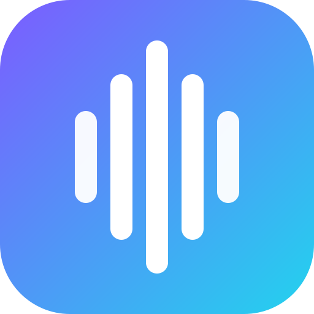

<p align="center">
  
</p>

<h1 align="center">Sonora</h1>

<p align="center">Dictée vocale en temps réel pour macOS, Windows et Linux, tapée à votre curseur.</p>

<p align="center">
  <a href="https://github.com/Devitek/sonora/releases/latest"></a>
  <a href="https://github.com/Devitek/sonora/actions/workflows/ci.yml"></a>
  <a href="https://github.com/Devitek/sonora/releases"></a>
  <a href="LICENSE"></a>
</p>

<p align="center">
  <a href="https://sonora.devitek.fr/fr/">Site</a> ·
  <a href="#installation">Installation</a> ·
  <a href="#utilisation">Utilisation</a> ·
  <a href="#documentation">Documentation</a> ·
  <a href="CONTRIBUTING.md">Contribuer</a> ·
  <a href="README.md">English</a>
</p>

Sonora est une barre flottante façon Spotlight, toujours à portée de raccourci : vous appuyez, vous parlez, le texte s'écrit en direct, puis il arrive dans le presse-papier ou est tapé directement à l'endroit de votre curseur. Branchez le moteur de votre choix (Gemini, Mistral, OpenAI, Groq, n'importe quel endpoint compatible OpenAI) ou Whisper 100 % local et hors-ligne. Une alternative gratuite et open source à Wispr Flow et superwhisper.

> [!NOTE]
> Sonora a été conçu et codé de bout en bout par un agent IA, en binôme avec un humain qui orientait et testait. À prendre comme une démonstration de ce qu'on peut bâtir ainsi, et à relire pour tout ce qui touche à la sécurité.

## Installation

Téléchargez le build de votre système depuis la [dernière release](https://github.com/Devitek/sonora/releases/latest) : `.dmg` (Apple Silicon et Intel), `.msi` ou `.exe` (Windows), `.AppImage` ou `.deb` (Linux).

**NixOS / Nix** : le flake fournit un paquet natif, recommandé plutôt que l'AppImage (qui bute sur les pilotes EGL / bubblewrap) :

```sh
nix run github:Devitek/sonora
```

## Utilisation

Ouvrez les **Réglages** (⚙ sur la barre), choisissez un fournisseur de transcription et collez sa clé API (stockée dans le trousseau du système). En option : micro, modèle, langue, URL de base ou modèle `ggml` local, nettoyage automatique et prompts de reformulation. Démarrez et arrêtez ensuite la dictée avec le raccourci global.

| Fournisseur | Transcription | Reformulation | Clé requise | Hors-ligne |
| --- | --- | :---: | :---: | :---: |
| **Gemini Live** | streaming, mot à mot | ✓ | oui | — |
| **Mistral (Voxtral)** | par segment | ✓ | oui | — |
| **OpenAI Whisper** | par segment | ✓ | oui | — |
| **Groq Whisper** | par segment | ✓ | oui | — |
| **Compatible OpenAI** | par segment | ✓ | selon l'hôte | possible |
| **Whisper local** (ggml) | par segment | — | non | ✓ |

« Par segment » découpe la parole par détection d'activité vocale et transcrit chaque segment ; Gemini Live diffuse le texte en continu.

## Fonctionnalités

- **Dictée en streaming** : le texte apparaît pendant que vous parlez (Gemini Live).
- **Frappe au curseur**, ou copie dans le presse-papier.
- **Raccourci global** : démarrer et arrêter sans quitter votre application.
- **Nettoyage des hésitations** : retire les « euh », faux départs et répétitions.
- **Prompts de reformulation** : passez une dictée dans un LLM avec vos propres prompts (« réécris formellement », « convertis en commande terminal »…).
- **Historique** des dictées, **thème** clair / sombre / système, **waveform** en direct.
- **Clés API dans le trousseau du système** (repli fichier `0600`), jamais en clair côté frontend.

## Barre flottante sous Hyprland

Sonora est une fenêtre transparente, sans décoration ni focus. Sous un compositeur en tuiles, rendez-la flottante et liez le raccourci (syntaxe `match:` des versions récentes d'Hyprland) :

```ini
windowrule = float on,            match:title ^(Sonora)$
windowrule = move (monitor_w/2)-240 40, match:title ^(Sonora)$
windowrule = border_size 0,       match:title ^(Sonora)$
windowrule = no_shadow on,        match:title ^(Sonora)$
windowrule = rounding 0,          match:title ^(Sonora)$
windowrule = no_blur on,          match:title ^(Sonora)$
windowrule = pin on,              match:title ^(Sonora)$
windowrule = no_initial_focus on, match:title ^(Sonora)$

# Push-to-talk : une 2e instance transmet l'action à celle qui tourne
bind = SUPER, V, exec, sonora toggle
```

## Développement

Prérequis : Rust (stable), Bun et les [dépendances système de Tauri](https://tauri.app/start/prerequisites/).

```sh
bun install
bun run tauri dev      # développement
bun run tauri build    # binaire dans src-tauri/target/release/sonora
```

Sous Nix, `nix develop` fournit toute la chaîne ; puis `bash scripts/dev.sh`. Les réglages peuvent aussi venir d'un fichier `.env` (voir [`.env.example`](.env.example)). La CI vérifie les types Svelte et lance `cargo fmt`, `clippy -D warnings` et `cargo check` sous Windows et macOS, plus le build Nix, CodeQL et les audits de dépendances ; les releases se font depuis *Actions → Release* avec un bump SemVer.

## Documentation

- [Site et documentation](https://sonora.devitek.fr/fr/)
- [Charte graphique](brand/) : logo, symbole, couleurs (violet `#7C5CFF` → cyan `#22D3EE`, fond `#0A0B12`), typographies

## Contribuer

Les contributions sont bienvenues. Lisez d'abord [CONTRIBUTING.md](CONTRIBUTING.md) : une issue par changement, Conventional Commits, CI verte.

## Licence

Publié sous [licence MIT](LICENSE).

---

<p align="center">
  <a href="https://github.com/Devitek">
    <picture>
      <source media="(prefers-color-scheme: dark)" srcset=".github/assets/devitek-wordmark-blanc.svg">
      
    </picture>
  </a>
  <br>
  <sub>Built and maintained by <a href="https://github.com/Devitek">Devitek</a></sub>
</p>
